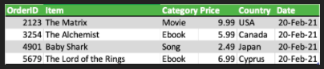
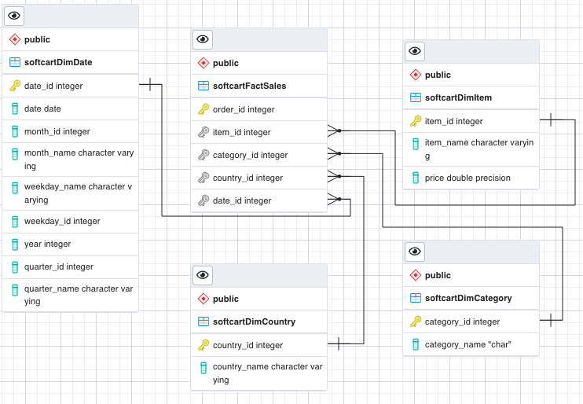
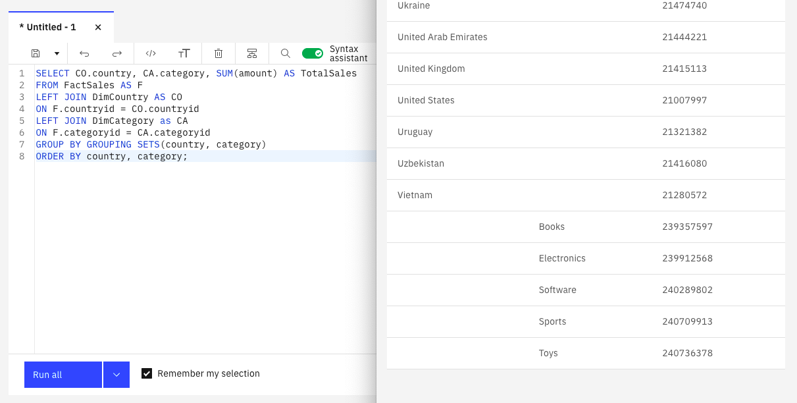
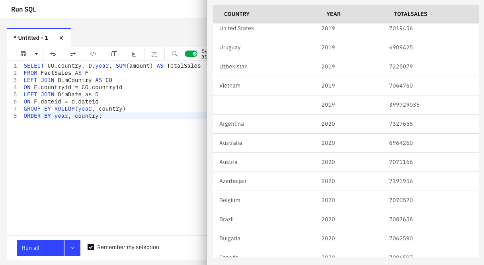
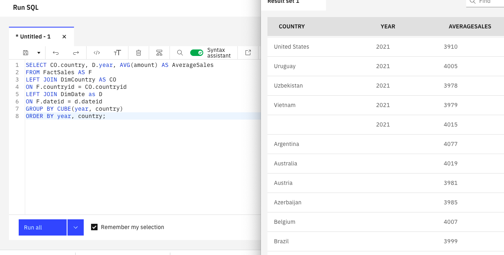
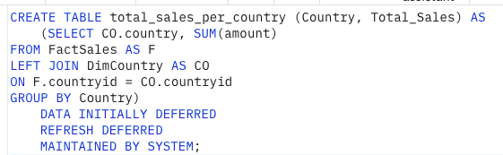

# SoftCart Data Warehouse

A sales data warehouse for **SoftCart**, a fictional online retailer selling books, electronics,
software, sports gear, and toys in 56 countries. I designed a star schema in PostgreSQL, then
used IBM Db2 to analyze three years of sales with `GROUPING SETS`, `ROLLUP`, and `CUBE`, and to
precompute totals in a materialized query table.

Built for the IBM Data Engineering Professional Certificate (2022).

**Skills:** dimensional modeling (star schema) · PostgreSQL and the pgAdmin ERD tool · IBM Db2 ·
OLAP aggregation (`GROUPING SETS`, `ROLLUP`, `CUBE`) · materialized query tables

## 1. Designing the schema

The source data has one row per sale:



I split it into a star schema: a fact table of orders surrounded by four dimension tables, so
each analysis joins only the dimensions it needs.

| Table | Type | Holds |
|---|---|---|
| `softcartFactSales` | Fact | One row per order, with a key to each dimension |
| `softcartDimDate` | Dimension | Date, weekday, month, quarter, and year |
| `softcartDimItem` | Dimension | Item name and price |
| `softcartDimCategory` | Dimension | Product category |
| `softcartDimCountry` | Dimension | Country |



Full DDL, exported from pgAdmin's ERD tool: [`schema/softcart_schema.sql`](schema/softcart_schema.sql)

## 2. Analyzing sales in IBM Db2

With the course's 2019–2021 sales data loaded into IBM Db2, each query below produces several
levels of totals in a single pass instead of one query per level. Each one links to the SQL and
to its full output as CSV.

The Db2 dataset uses its own table names (`FactSales`, `DimCountry`, `DimDate`, `DimCategory`),
and its fact table carries the sale `amount` that the queries aggregate.

### Sales by country and by category: `GROUPING SETS`

Two independent breakdowns in one result: total sales for each country, then total sales for
each category.

[SQL](queries/grouping_sets.sql) · [Results](results/grouping_sets.csv)



### Sales by year and country, with subtotals: `ROLLUP`

Total sales for every country in every year, plus a subtotal for each year and a grand total.

[SQL](queries/rollup.sql) · [Results](results/rollup.csv)



### Average sales across every combination: `CUBE`

Average sales for every combination of year and country: each country in each year, each year
across all countries, each country across all years, and overall.

[SQL](queries/cube.sql) · [Results](results/cube.csv)



### Precomputed totals: materialized query table

A materialized query table (MQT) stores total sales per country, so reports can read the
answer instead of re-aggregating the whole fact table each time. It is created with
`REFRESH DEFERRED`, so Db2 recomputes it when `REFRESH TABLE` is run rather than on every write.

[SQL](queries/total_sales_per_country_mqt.sql)



## Repository layout

```
schema/    star schema DDL (PostgreSQL)
queries/   OLAP queries and the materialized query table (IBM Db2)
results/   query output, exported as CSV
images/    ERD, sample data, and query screenshots
```
